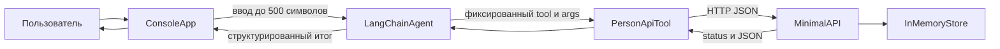

# План реализации LangChain CLI и Minimal API

## Архитектурное решение

- Создать solution с двумя запускаемыми проектами и тестами: `src/PersonAgent.Console`, `src/PersonApi`, `tests`.
- Использовать Ollama по `http://localhost:11434`; адрес API, адрес Ollama и имя модели вынести в конфигурацию/переменные окружения и описать в `.env.example` без секретов.
- Реализовать четыре фиксированных инструмента: `CreatePerson`, `GetPerson`, `UpdatePerson`, `ListPersons`. Каждый LangChain tool валидирует типизированные аргументы и через общий HTTP-клиент вызывает только соответствующий endpoint Minimal API.
- Считать tool call структурированным контрактом `{ "name": "...", "args": { ... } }`; не исполнять произвольные имена/URL. Итог пользователю формировать по `Prompts/system.prompt` как `Status / Action / Data / Errors`.

## Этапы реализации

1. **Каркас и зависимости**
   - Создать solution и проекты под актуальную LTS-версию .NET; зафиксировать версии NuGet-пакетов в `.csproj`/централизованном файле зависимостей.
   - Перед реализацией подтвердить актуальные пакеты LangChain для .NET и интеграции Ollama по официальной документации; не подменять LangChain другим агентным фреймворком.
   - Подготовить конфигурацию, DI, логирование и отдельные launch-профили, чтобы API и CLI запускались независимо.

2. **Minimal API**
   - Определить минимальную модель физлица и DTO создания/обновления с обязательной валидацией.
   - Реализовать `POST /persons`, `GET /persons/{id}`, `PUT /persons/{id}`, `GET /persons` поверх потокобезопасного in-memory-хранилища.
   - Возвращать предсказуемые JSON-контракты и корректные HTTP-коды (`201/200`, `400`, `404`); подключить OpenAPI/Swagger.
   - Добавить endpoint/integration-тесты для успешных операций, невалидных данных и отсутствующего id.

3. **Консольный LangChain-агент**
   - Принимать аргумент командной строки либо интерактивный ввод; пустой ввод и текст длиннее 500 символов отклонять до обращения к модели.
   - Создать типизированный API-клиент с обработкой timeout, недоступности API, неуспешных кодов и некорректного JSON.
   - Оформить четыре операции как LangChain tools с явными схемами аргументов, реальными HTTP-вызовами и диагностическим логом вызова/результата без чувствительных данных.
   - Настроить Ollama и агента системным prompt; при недостатке обязательных данных агент задаёт уточнение, неподдерживаемый запрос не вызывает tool, а последовательный запрос может вызвать несколько tools.
   - Преобразовывать результат tool/API в краткий фиксированный ответ, не печатая пользователю сырой JSON и не заявляя об успехе при ошибке.

4. **Промпты и защита контракта**
   - Уточнить `Prompts/system.prompt`: перечислить разрешённые tools, обязательность их вызова для действий, правила уточнения, запрет выдуманных параметров/результатов и точный формат финального ответа.
   - Сохранить пользовательские шаблоны/примеры в `Prompts` и описать назначение каждого в отчёте.
   - Добавить проверки неизвестного имени инструмента, неверных аргументов и попытки передать произвольный endpoint.

5. **Проверка и сдача**
   - Выполнить минимум 5 сценариев: создание, получение, изменение, список/последовательный запрос, отсутствующие данные или неподдерживаемая операция; минимум 3 должны подтверждаться реальным HTTP-вызовом tool.
   - Отдельно проверить лимит 500 символов, `404`, недоступность API/Ollama и отсутствие ложного сообщения об успехе.
   - В `REPORT.md` зафиксировать запросы, ответы и фрагменты логов/trace, а после реализации — точные файлы и диапазоны строк объявления tool, HTTP-вызова и debug-лога.
   - Заполнить `README.md` и `Launch.md`: требования, модель Ollama, настройка, команды запуска обоих приложений, API-операции, контракт ответа и troubleshooting.
   - Описать фактическую архитектуру текстом и сверить её с Mermaid-диаграммой и реальным потоком выполнения; затем прогнать сборку и все тесты.
