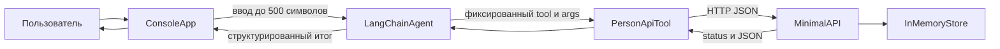

# Учёт физических лиц: LangChain-агент и Minimal API

Консольное приложение на C# принимает запрос на русском языке, передаёт его агенту [LangChain .NET](https://github.com/tryAGI/LangChain) и выполняет одну из четырёх операций учёта физических лиц через отдельный HTTP API. Модель по умолчанию локальная: Ollama на `http://localhost:11434`, без API-ключа.

Короткий порядок запуска — в [Launch.md](Launch.md). Отчёт, сценарии и сверка с ТЗ — в [REPORT.md](REPORT.md).

## Состав

| Проект | Назначение |
| --- | --- |
| `src/PersonApi` | Minimal API и Swagger. Хранилище в памяти процесса. |
| `src/PersonAgent.Core` | LangChain ReAct-агент, четыре tool, HTTP-клиент, формат ответа. |
| `src/PersonAgent.Console` | Ввод пользователя и запуск агента. |
| `tests/PersonApi.Tests` | Интеграционные тесты API. |
| `tests/PersonAgent.Tests` | Путь агент → tool → HTTP на тестовом двойнике `FakeChatClient` и opt-in тест живой модели. |



Диаграмма совпадает с выполнением. Консоль не вызывает произвольный URL: LangChain tool проверяет аргументы и через `PersonApiClient` обращается только к своему методу API. Итог для человека собирается из результата tool, а не из сырого JSON.

## Требования

- .NET SDK 10 (текущая LTS). В этой среде проверено на SDK 10.0.402.
- Запущенный [Ollama](https://ollama.com/) и скачанная модель, если нужен живой ответ модели. Для `dotnet test` Ollama не нужен.
- Отдельный терминал с Minimal API, если консоль ходит в API по сети.

Версии NuGet зафиксированы в `Directory.Packages.props`, фактическое дерево — в `packages.lock.json`. Это замена Python-файлов `requirements.txt` / `pyproject.toml`: см. [requirements.md](requirements.md).

## Настройка Ollama

```bash
ollama serve
ollama pull qwen3.5:4b
cp .env.example .env
```

По умолчанию, даже без `.env`:

| Параметр | Значение |
| --- | --- |
| API | `http://localhost:5080` |
| Ollama | `http://localhost:11434` |
| Модель | `qwen3.5:4b` |

Адрес API — корень сервера Ollama, без `/api` и без `/v1`. Клиент сам вызывает `POST /api/chat`. Ключ не используется.

Переменные окружения и `.env` (пустые значения пропускаются, уже заданные переменные не перезаписываются):

| Переменная | Куда попадает |
| --- | --- |
| `PERSON_API_BASE_URL` | `PersonApi:BaseUrl` |
| `PERSON_API_TIMEOUT_SECONDS` | `PersonApi:TimeoutSeconds` |
| `OLLAMA_BASE_URL` | `Ollama:BaseUrl` |
| `OLLAMA_MODEL` | `Ollama:Model` |
| `OLLAMA_TIMEOUT_SECONDS` | `Ollama:TimeoutSeconds` |
| `AGENT_MAX_ACTIONS` | `Agent:MaxActions` |
| `LLM_PROVIDER` | `Ollama` или `OpenAICompatible` |
| `LLM_BASE_URL`, `LLM_MODEL`, `LLM_API_KEY` | только для `OpenAICompatible` |

Те же поля есть в `src/PersonAgent.Console/appsettings.json`.

`LLM_PROVIDER=OpenAICompatible` переключает консоль на любой OpenAI-совместимый endpoint (`/v1/chat/completions`), в том числе Ollama по адресу `http://localhost:11434/v1`. Для локальной Ollama этот режим не обязателен: штатный путь — нативный `/api/chat`.

## Запуск

Два процесса. Сначала API:

```bash
dotnet run --project src/PersonApi
```

Swagger UI: [http://localhost:5080/swagger](http://localhost:5080/swagger).

Затем консоль. Одна фраза аргументом или интерактивный ввод, если аргументов нет:

```bash
dotnet run --project src/PersonAgent.Console -- "Создай физлицо: фамилия Иванов, имя Иван"
dotnet run --project src/PersonAgent.Console
```

Ввод длиннее 500 символов и пустой ввод не отправляются модели. Код выхода `0` — в ответе `Status: success`, иначе `1`. Диагностические логи пишутся в stderr, четыре строки ответа — в stdout.

## Операции API

| Метод | HTTP | Успех | Ошибки |
| --- | --- | --- | --- |
| CreatePerson | `POST /persons` | `201` и карточка, заголовок `Location` | `400` |
| GetPerson | `GET /persons/{id}` | `200` | `400` если id не положительный, `404` если нет |
| UpdatePerson | `PUT /persons/{id}` | `200` | `400`, `404` |
| ListPersons | `GET /persons` | `200`, `{ "items": [], "count": 0 }` | — |

Тело создания:

```json
{
  "lastName": "Иванов",
  "firstName": "Иван",
  "middleName": "Иванович",
  "birthDate": "1990-05-01"
}
```

Обязательны `lastName` и `firstName`. `middleName` и `birthDate` необязательны. Дата в формате `ГГГГ-ММ-ДД`, не раньше `1900-01-01` и не в будущем (по UTC). Имя — от 1 до 100 символов: буквы, пробел, дефис, апостроф.

Обновление частичное: в теле хотя бы одно из тех же полей. Непереданные поля не меняются. Сбросить отчество или дату в пустое значение этим контрактом нельзя.

Ошибка:

```json
{
  "status": 400,
  "title": "Некорректные данные",
  "errors": { "lastName": ["Укажите фамилию"] }
}
```

Для `404` заголовок — `Физлицо не найдено`. Данные живут только в памяти процесса API и пропадают после перезапуска.

## Контракт ответа человеку

Требования к формату: `Prompts/system.prompt` (строки 40–43) и `src/PersonAgent.Core/Agent/ResponseFormatter.cs`.

```text
Status: success | error
Action: CreatePerson
Data: Готово. Физлицо создано. Идентификатор: 1.
Errors: нет
```

Метки совпадают с контрактом преподавателя: `Status`, `Action`, `Data`, `Errors`. Текст внутри полей остаётся на русском. Значения статуса — `success` и `error`.

Успешное изменение физлица содержит фразу `Готово. Данные физлица изменены`. Сырой JSON в эти четыре строки не попадает. Если модель написала об успехе, но tool не вызывался или API вернуло ошибку, статус будет `error`.

Уточнение и неподдерживаемая операция тоже приходят в этих четырёх строках со статусом `error`: действие не выполнено. Для уточнения в поле `Action` будет `уточнение`.

## Инструменты агента

Агент — `Chain.ReActAgentExecutor` из пакета LangChain 0.17.1. Разрешены только:

| Action | Метод API |
| --- | --- |
| `CreatePerson` | `POST /persons` |
| `GetPerson` | `GET /persons/{id}` |
| `UpdatePerson` | `PUT /persons/{id}` |
| `ListPersons` | `GET /persons` |

Внутри tool аргументы — JSON. В лог пишется контракт `{"name":"CreatePerson","args":{...}}`: строки фамилии и имени заменяются на `***`, id остаётся. Произвольное имя tool, лишние поля и поля `url` / `endpoint` / `path` отклоняются до HTTP. Клиент умеет ходить только на относительные пути `persons` и `persons/{id}` и не следует редиректам.

`ReActAgentExecutor` ищет tool по имени в нижнем регистре. Поэтому имя в библиотеке — `createperson`, а в контракте, логе и ответе человеку — `CreatePerson`. Модель может написать любой регистр.

Несколько действий за один запрос выполняются по очереди, не больше `Agent:MaxActions` (по умолчанию 6).

## Тесты и CI

```bash
dotnet test
```

Ollama и сеть наружу не нужны. Модель в основных тестах заменена двойником `FakeChatClient`, который возвращает заранее заданный текст ReAct. HTTP идёт в тестовый сервер API.

Тот же прогон выполняет GitHub Actions: `.github/workflows/ci.yml`. Workflow стартует на каждый push любой ветки и на pull request, ставит SDK из `global.json`, делает `dotnet restore --locked-mode`, затем сборку и `dotnet test`. Живой LLM-тест в CI пропускается, потому что переменные `LLM_INTEGRATION_*` там не заданы.

Живая модель — opt-in. Тест пропускается, пока не заданы обе переменные:

```bash
export LLM_INTEGRATION_BASE_URL=http://localhost:11434/v1
export LLM_INTEGRATION_MODEL=qwen3.5:4b
export LLM_INTEGRATION_API_KEY=ollama
dotnet test --filter LiveModel_CreatePerson_WhenConfigured
```

Подойдёт любой OpenAI-совместимый endpoint. Cursor Composer в этой среде отдельным URL не опубликован, поэтому отдельного теста «против Composer» нет: тот же тест закрывает такой endpoint, если URL и модель заданы снаружи.

## Если что-то не работает

| Симптом | Что проверить |
| --- | --- |
| `Ollama недоступен` | `ollama serve`, адрес `OLLAMA_BASE_URL` без `/api` |
| Модель не найдена | `ollama pull qwen3.5:4b` или другое имя в `OLLAMA_MODEL` |
| `API недоступен` | Сначала запущен `src/PersonApi`, порт совпадает с `PERSON_API_BASE_URL` |
| `модель вернула ответ не в формате ReAct` | Модель слабая для формата Thought/Action. Попробуйте `qwen3.5:4b` или другую инструкционную модель |
| `длина текста превышает 500 символов` | Сократите запрос. Модель при этом не вызывается |
| `Физлицо не найдено` | id есть в текущем процессе API. После перезапуска API хранилище пустое |
| В ответе `error`, хотя казалось, что всё вышло | Смотрите поле `Errors`. Успех не печатается без успешного tool |
| Opt-in тест пропущен | Не заданы `LLM_INTEGRATION_BASE_URL` и `LLM_INTEGRATION_MODEL` |

Логи консоли — в stderr. Туда попадают имя tool, контракт с замаскированными полями и HTTP-статус, без значения фамилии и имени.
